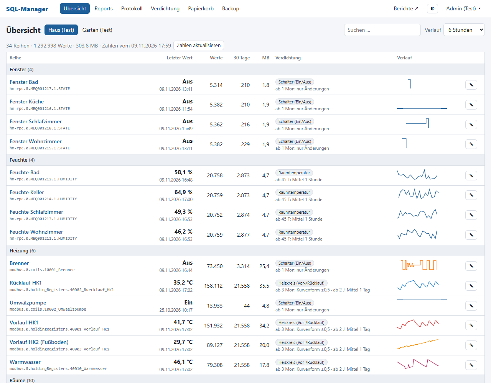
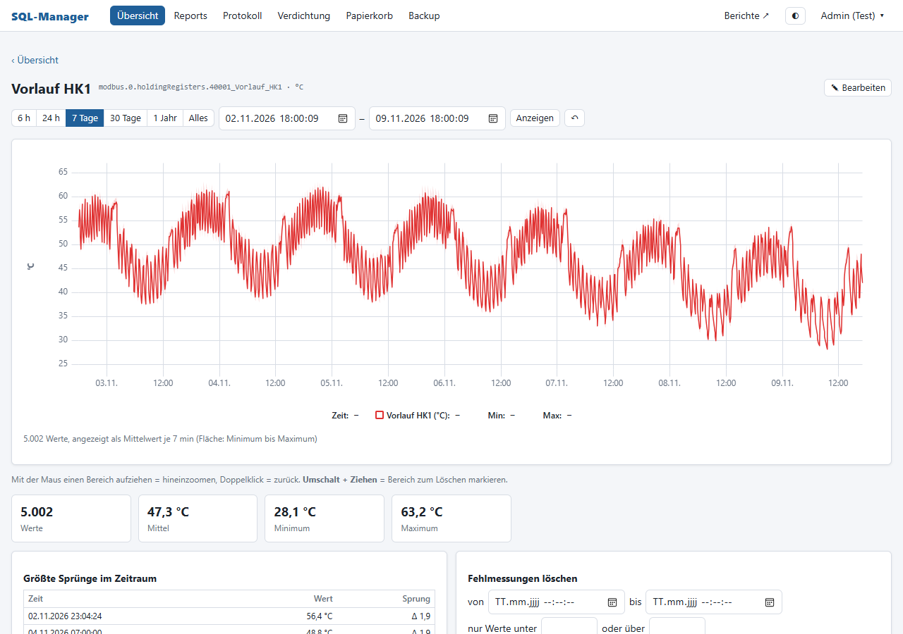
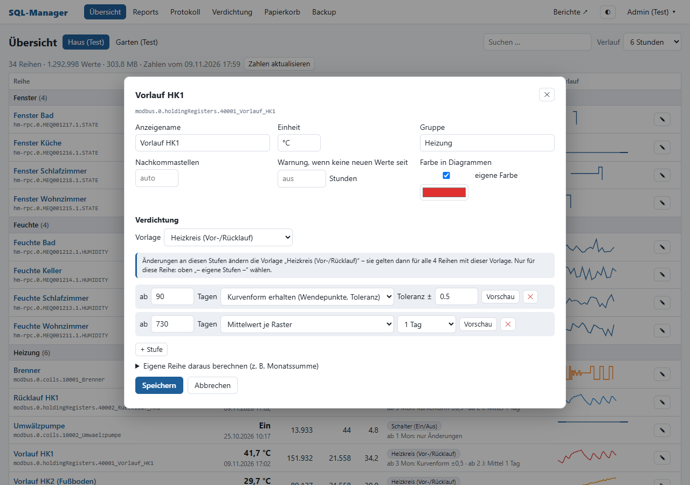
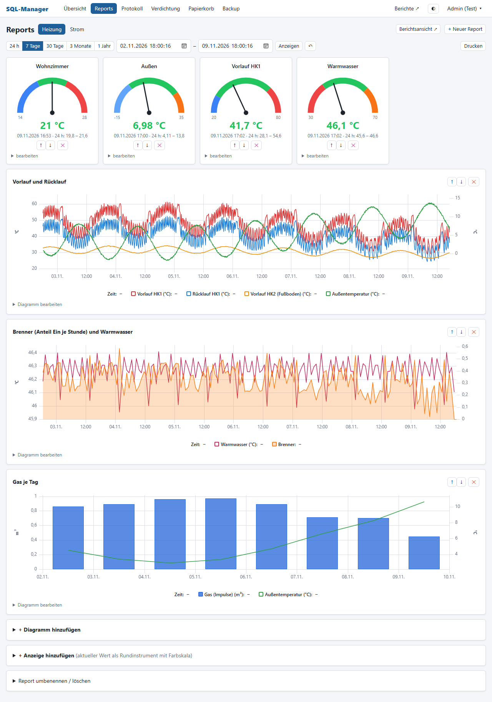
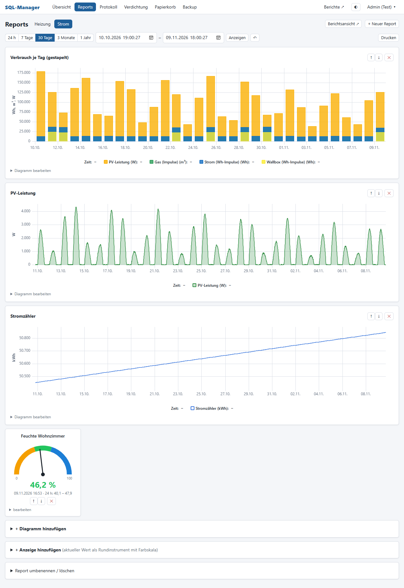
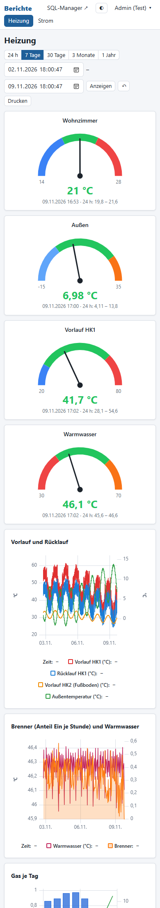

# SQL-Manager für ioBroker

*Shows, manages and shrinks time series data in SQL databases written by ioBroker – with graphical reports. (UI and docs in German.)*

Messdaten aus dem **ioBroker-SQL-Adapter** (MySQL/MariaDB) ansehen, Fehlmessungen löschen und **alte Werte verdichten**. Dazu Diagramme, Reports und Rundinstrumente, so dass Grafana entfallen kann.

> **Hinweis:** Der Code wurde von einer KI geschrieben (Claude von Anthropic, über Claude Code). Ich habe die Anforderungen beschrieben, Fragen beantwortet und getestet. Das Projekt ist als **Anregung** gedacht, nicht als fertiges, gepflegtes Produkt. Die Arbeitsnotizen der KI stehen in [`CLAUDE.md`](CLAUDE.md).
>
> **Stand: Prototyp.** Getestet mit künstlichen Daten (rund 5 Mio. Werte über 2 Jahre), noch nicht lange im Echtbetrieb. **Vor dem ersten Verdichten ein Backup machen**, denn verdichtete Werte lassen sich nicht zurückholen.

## Warum?

- Nach dem Hin und Her um InfluxDB 2/3 und Flux sind die Daten jetzt im SQL-Adapter. Der Adapter kann alte Daten aber nur **löschen, nicht verdichten**, und die Tabellen wachsen immer weiter.
- Für Diagramme brauchte man trotzdem Grafana, also noch einen Dienst mehr.

## Was es kann

- **Übersicht** aller Datenpunkte mit letztem Wert, Anzahl, Speicherbedarf und Mini-Diagramm. Eine Warnung erscheint, wenn ein Sensor zu lange schweigt.
- **Große Diagramme mit Zoom.** Fehlmessungen per Umschalt + Ziehen markieren und löschen. Gelöschte Werte landen im Papierkorb (30 Tage wiederherstellbar).
- **Verdichtung in Stufen je Datenpunkt**, per Cron. Beispiel: 45 Tage alles behalten, danach Stundenmittel, nach 2 Jahren Tagesmittel.
  - Methoden: Mittelwert, Summe, letzter Wert, nur Änderungen (Schalter), Löschen.
  - „Kurvenform erhalten“: Es bleiben nur die Punkte, die die Kurve prägen.
  - Vorlagen gelten für viele Reihen auf einmal, eine Vorschau zeigt das Ergebnis vor dem Speichern.
  - In den Testdaten wurden aus 4,4 Mio. Werten rund 0,6 Mio.
- **Eigene Reihen**, z. B. Tages- oder Monatssummen aus Wh-Impulsen oder der Verbrauch aus Zählerständen.
- **Reports:** Linie, Balken, Fläche, Treppe, gestapelt in wählbarer Reihenfolge, zwei Achsen, Werte je Tag oder Monat zusammengefasst, eigene Farben. Dazu **Rundinstrumente** mit Farbbereichen und eine schlanke **Berichtsansicht** fürs Handy oder Tablet.
- **Backup** als `.sql.gz` (ohne mysqldump), zum Herunterladen oder per Cron in einen Ordner.
- **Mehrere Messdatenbanken**, Benutzer mit den Rollen Admin und Leser, Login-Sperre nach Fehlversuchen, CSRF-Schutz und eine strenge Content-Security-Policy.

Die Tabellen des Adapters bleiben unverändert. Wer Grafana behalten will, kann es weiter nutzen, die Abfragen funktionieren wie vorher.

## Bilder

Übersicht mit Mini-Diagrammen und Verdichtungsstufen:

Eine Reihe im Detail (Zoom, Kennzahlen, Fehlmessungen löschen):

Bearbeiten einer Reihe mit Verdichtungsstufen:

Report mit Rundinstrumenten, Linien und Balken je Tag:

Gestapelte Balken je Tag, Fläche und Zählerstand:

Berichtsansicht auf dem Handy:

## Voraussetzungen

- Webspace mit **PHP 8** (entwickelt und getestet mit 8.5), PDO für MySQL und SQLite, Apache mit `.htaccess`.
- Die MySQL-/MariaDB-Datenbank des ioBroker-SQL-Adapters muss vom Webspace aus erreichbar sein.
- Ein Cron-Job für die Verdichtung (beim Hoster oder per URL-Aufruf).
- Keine Frameworks, kein Composer, kein Build-Schritt. Einzige Fremdbibliothek ist [uPlot](https://github.com/leeoniya/uPlot) (MIT), liegt in `vendor/`.

## Einrichtung

1. Alle Dateien per FTP hochladen, z. B. nach `/sql/`.
2. `config.example.php` als `config.php` kopieren und ausfüllen: Einrichtungspasswort, Cron-Token (mindestens 16 Zeichen) und Zugang zur Datenbank.
3. Die Seite aufrufen und mit dem Einrichtungspasswort den ersten Admin anlegen.
4. Im SQL-Adapter die **Vorhaltezeit auf „nie löschen“** stellen. Das Aufräumen übernimmt der SQL-Manager.
5. Einen Cron-Job einrichten, z. B. alle 10 Minuten:
   - per Kommandozeile: `php /pfad/zu/sql/cron.php`
   - oder per URL: `https://example.org/sql/cron.php?token=DEIN-CRON-TOKEN`
   - Backup per Cron: `php cron.php --backup` bzw. `cron.php?token=…&backup=1`

Die App legt in der Messdatenbank eigene Tabellen mit dem Präfix `sm_` an. Ihre eigenen Einstellungen speichert sie in SQLite (`data/`).

## Lizenz

[MIT](LICENSE). Nutzung auf eigene Gefahr.
